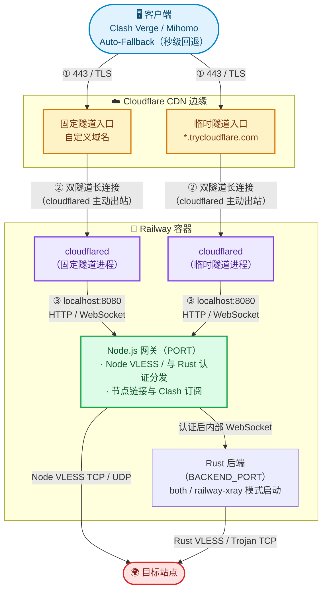

# Railway Cloudflare Tunnel 双隧道节点（Node / Railway Xray）

[](https://railway.app/new)

> **Cloudflare Tunnel 双隧道（固定 + 临时并行） + 默认 Node / Railway Xray 双后端 + Clash / Mihomo 订阅**
>
> 流量链路：`客户端 → Cloudflare CDN (443/TLS) → Cloudflare Tunnel → cloudflared → Node.js 网关 / 订阅服务 → 所选后端 → 目标站点`
>
> 整理时间：2026-07-31
> 后端合并与默认并行：2026-11-09；50 项自动化测试及真实 Rust 隔离验证通过，详见[验证记录](docs/verification-2026-11-09.md)。

---

## 一、方案概述

本方案在单隧道的基础上升级为 **Cloudflare Tunnel 双隧道架构** 并内置 **Clash / Mihomo YAML 订阅服务器**。在维持超低内存与成本的同时，实现了节点的高度稳定与自动化切换。

当前部署代码完全位于本目录，包括 `railway-xray/` 子目录，无需引用相邻的独立部署目录。`PROXY_BACKEND=both` 为默认值，在同一个公网端口同时运行两种后端：原有 Node VLESS `/` 保留 TCP/UDP/XUDP，认证网关将 Rust VLESS `/vless` 和 Trojan `/trojan` 转发到固定 v0.1.4 Rust 后端，Rust 两种协议均仅支持 TCP。

| 后端 | 设置 | 协议与范围 |
|---|---|---|
| 双后端（默认） | `PROXY_BACKEND=both` 或省略 | Node VLESS `/` TCP/UDP/XUDP；Rust VLESS `/vless`、Trojan `/trojan` 仅 TCP |
| 仅 Node | `PROXY_BACKEND=node` | 原有 VLESS-WS `/` TCP/UDP/XUDP |
| 仅 Railway Xray | `PROXY_BACKEND=railway-xray` | Rust VLESS `/`（兼容 `/vless`）、Trojan `/trojan`，仅 TCP |

`both` 和 `railway-xray` 模式必须显式提供有效的固定 `uuid`；`TROJAN_PASSWORD` 省略时使用该 UUID。只有显式 `node` 模式不启动 Rust 子进程。三种模式均保留 `/:uuid`、`/:uuid/clash`、固定/临时隧道和各自的优选 IP 节点。切换后端后重新导入订阅即可取得对应协议配置。

**已有 Railway 服务若显式设置了 `PROXY_BACKEND=node` 或 `PROXY_BACKEND=railway-xray`，需要将其改为 `both`，或删除该变量后重新部署，才会使用新的双后端默认值。** Railway 已有变量会覆盖镜像默认设置。双后端比仅 Node 多一个 Rust 后端进程；Rust 启动失败时服务会退出，不会悄悄只留下其中一种后端。

### 与现有方案对比

| 维度 | quick-deploy (直连) | 传统单 Cloudflare Tunnel 隧道 | **本方案 (Cloudflare Tunnel 双隧道)** | 完整 cloudflare_tunnelsbx |
|---|---|---|---|---|
| **抗封能力** | ❌ Railway 域名特征明显 | ✅ 隐藏在 CF 后 | ✅ **双重防护 + 自动备用** | ✅ 同等 |
| **高可用性** | ❌ 依赖单域名 | ⚠️ 依赖固定或临时单隧道 | ⚡ **固定 + 临时双隧道并发** | ⚠️ 依赖单隧道 |
| **Clash 订阅** | ❌ | ❌ | ✅ **内置 Clash/Mihomo 自动回退订阅** | ❌ 需额外转换 |
| **启动速度** | ⚡ 秒级 | ⚡ 秒级 | ⚡ **秒级（ cloudflared 预编译）** | 🐢 慢 |
| **运行内存** | ~40MB | ~70MB | **~100MB** | ~200MB+ |
| **月成本估算** | ~$3 | ~$3.5 | **~$1.60 ~ $3.50** | ~$6+ |
| **CDN 优选 IP** | ❌ | ✅ 支持 | ✅ **双节点同时支持优选 IP** | ✅ 支持 |

### 架构图（默认双后端最多 4 个服务进程，仅 Node 最多 3 个）



---

## 二、Railway 成本分析

### 计费规则

| 计费项 | 单价 | 说明 |
|---|---|---|
| vCPU | $0.000463/vCPU/分钟 | 按实际使用量 |
| 内存 | $0.000231/GB/分钟 | 按实际使用量 |
| 出站流量 | $0.10/GB | 每月含 100GB 免费 |
| 磁盘 | $0.000231/GB/分钟 | 含 1GB 免费 |

### 仅 Node 模式资源占用（历史估算）

以下资源与成本数字来自原 Node 模式的估算，未覆盖新增 Rust 进程，也不代表当前 Railway 报价或本次测量结果；实际用量请查看账户面板。

| 组件 | 进程数 | CPU | 内存 | 说明 |
|---|---|---|---|---|
| Node.js VLESS + Web/Sub | 1 | ~0.01 vCPU (空闲) | ~40MB | 纯 JS，处理代理及订阅 |
| cloudflared (临时隧道) | 1 | ~0.01 vCPU (空闲) | ~30MB | 始终启动（保底备用） |
| cloudflared (固定隧道) | 1 (可选) | ~0.01 vCPU (空闲) | ~30MB | 配置 Token 后启动 |
| **合计（双隧道空闲）** | **3 进程** | **~0.03 vCPU** | **~100MB** | **超低资源消耗** |
| **合计（单临时隧道空闲）**| **2 进程** | **~0.02 vCPU** | **~70MB** | 未配置 Token 时 |

### 月成本估算（24×7 运行）

| 场景 | vCPU 费 | 内存费 | 合计 |
|---|---|---|---|
| **双隧道空闲待命** | $0.03 × $0.000463 × 43200 ≈ $0.60 | 0.10 × $0.000231 × 43200 ≈ $1.00 | **~$1.60/月** |
| **轻度使用** (4h/天) | ~$0.35 | ~$0.20 | **~$1.80/月** |
| **中度使用** (有传输) | ~$2.00 | ~$1.20 | **~$3.50/月** |

---

## 三、隧道模式说明

本项目的隧道架构支持两种运行模式，由环境变量决定：

| 模式 | 环境变量 | 说明 | 特点 |
|---|---|---|---|
| **仅临时隧道** | 只需设置 `uuid` | 只启动 1 个 cloudflared 进程，自动分配 `*.trycloudflare.com` | 免配置 Cloudflare 域名，适合快速试用（重启会变域名） |
| **双隧道并行** *(推荐)* | 设置 `uuid` + `CLOUDFLARE_TUNNEL_TOKEN` + `CLOUDFLARE_TUNNEL_DOMAIN` | 同时启动固定隧道和临时隧道，生成两组节点 | **固定节点作主用，临时节点作备用**，配合 Clash 自动回退，域名失效秒切 |

---

## 四、部署步骤

### 4.1 准备 GitHub 仓库

```bash
# 进入 cloudflare-tunnel 目录
cd /home/san/railway_docker/cloudflare-tunnel

# 初始化 Git 仓库
git init && git add . && git commit -m "railway cloudflare_tunnel dual-tunnel vless deploy"

# 在 GitHub 新建一个空仓库，然后推送：
git remote add origin https://github.com/<你的用户名>/railway-cloudflare_tunnel-node.git
git branch -M main
git push -u origin main
```

### 4.2 Railway 部署

如果你已经将仓库设为 Public（公开），你可以直接点击上方或者下方的**一键部署按钮**：

[](https://railway.app/new)

或者手动部署：
1. 登录 [Railway](https://railway.com/) → **New Project** → **Deploy from GitHub repo**
2. 选择你刚推送的仓库。
3. Railway 使用本目录的 Dockerfile 构建。如果部署整个工作区，将 **Root Directory** 设为 `/cloudflare-tunnel`，配置文件选择 `/cloudflare-tunnel/railway.json`；若本目录单独作为项目根目录，则保持默认根目录。

镜像统一使用带 glibc 的 `node:22-bookworm-slim`，安装 cloudflared 和经过 SHA256 校验的 `ryotwell/railway-xray` v0.1.4，支持 `amd64` / `arm64`，其他架构构建失败。镜像以非 root 的 `node` 用户运行，运行状态和日志写入 `/tmp`。本次未实际构建 Docker 镜像或部署 Railway。

### 4.3 设置环境变量向导

本项目已配置 `template.json` 自动向导，如果您通过模板部署或在 Railway 面板的 **Variables** 标签页中，您会看到如下的配置提示：

#### 模式一：仅临时隧道（最简配置）

* `uuid`：系统已自动为您生成了一个 UUID。如果不使用双隧道，只需保留此 UUID 即可直接部署运行。

#### 模式二：双隧道并行（推荐配置）

* `uuid`：保留系统生成的 UUID 或填入你自己的固定 UUID。
* `CLOUDFLARE_TUNNEL_TOKEN`：填入你从 Cloudflare 获取的隧道 Token（`eyJhIjoixxxx...`）。
* `CLOUDFLARE_TUNNEL_DOMAIN`：填入绑定的自定义域名（如 `your-proxy.example.com`）。
* `NAME`：自定义节点名称前缀。

> **可选：CF 优选 IP**
> 配置 `CF_IP` 变量即可（如 `CF_IP=104.16.0.1`，支持逗号分隔多个：`CF_IP=104.16.0.1,108.162.196.94`）。
> 设置后，每个优选 IP 各生成一个节点（Cloudflare-Tunnel-Fixed-1、Cloudflare-Tunnel-Fixed-2 ...），连接地址使用优选 IP，SNI/Host 仍维持 Cloudflare Tunnel 域名，配合 Auto-Fallback 自动选优。
> 未手动设置 `CF_IP` 时，启动脚本会自动从仓库根目录的 `result.csv`（CloudflareSpeedTest 测速结果）中提取丢包率为 0 且测速有效的前 5 个低延迟 IP——更新优选 IP 只需替换该文件并推送。

### 4.4 获取 Cloudflare Tunnel 固定隧道 Token（针对模式二）

1. 登录 [Cloudflare Dashboard](https://dash.cloudflare.com/)
2. 左侧 **Zero Trust** → **Networks** → **Tunnels**
3. 点 **Create a tunnel** → 选 **Cloudflared** → 输入隧道名称
4. 复制显示的 **Token**（`eyJhIjoixxxx...`）→ 填入 Railway 环境变量 `CLOUDFLARE_TUNNEL_TOKEN`
5. 在 **Public Hostname** 添加：
   - Subdomain + Domain = 你想用的域名（如 `proxy.example.com`）
   - Service Type = `HTTP`
   - URL = `localhost:8080`
6. 保存后将该域名填入 Railway 环境变量 `CLOUDFLARE_TUNNEL_DOMAIN`

---

## 五、获取节点与订阅

部署成功后，可通过以下方式使用节点：

### 5.1 节点链接提取

在浏览器或 HTTP 客户端访问：
```text
https://<Cloudflare Tunnel域名>/<你的UUID>
```
将返回纯文本节点导入链接（每行一条）：默认 `both` 包含 Node VLESS、Rust VLESS、Trojan 三类节点（`vless://` 和 `trojan://`）。显式 `node` 仅包含原有 VLESS，显式 `railway-xray` 包含 Rust VLESS 与 Trojan。Trojan 密码会正确编码。
- 包含已就绪的固定隧道节点与临时隧道节点（如 `vless://...`）
- 若隧道域名尚未就绪，则提示 `⏳ Cloudflare Tunnel 隧道域名尚未就绪，请稍后刷新`

### 5.2 Endpoint 列表

| Endpoint | 类型 | 说明 |
|---|---|---|
| `GET /:uuid` | **节点链接** | 默认返回 Node VLESS、Rust VLESS、Trojan，每行一条 |
| `GET /:uuid/clash` | **Clash / Mihomo YAML** | 返回符合 Mihomo / Clash 规范的完整 YAML 订阅 |

启动日志从本地 `/:uuid` 路由读取同一套链接，固定/临时隧道及优选 IP 的 SNI/Host 均使用相应隧道域名。链接、订阅 URL 和启动日志包含凭据，请勿公开。

默认 `both` 的订阅同时提供以下节点，优选 IP 节点在对应名称后追加编号；原有 Node 节点名称不变。

| 节点类别 | 固定 / 临时隧道节点名称 | WebSocket 路径 | 订阅 UDP |
|---|---|---|---|
| Node VLESS | `Cloudflare-Tunnel-Fixed` / `Cloudflare-Tunnel-Tmp` | `/` | `true` |
| Rust VLESS | `Cloudflare-Tunnel-Xray-Fixed` / `Cloudflare-Tunnel-Xray-Tmp` | `/vless` | `false` |
| Trojan | `Cloudflare-Tunnel-Trojan-Fixed` / `Cloudflare-Tunnel-Trojan-Tmp` | `/trojan` | `false` |

---

## 六、Clash / Mihomo 订阅使用

部署成功后，在 **Clash Verge Rev** / **Mihomo Party** / **Clash Nyanpasu** 中添加远程订阅：

**订阅 URL：**
```text
https://<Cloudflare Tunnel域名>/<你的UUID>/clash
```

### 订阅自动配置特性

1. **隧道域名节点（Cloudflare-Tunnel-Fixed + Cloudflare-Tunnel-Tmp）**：进入 `Proxy-Select` / `Auto-Fallback` 主代理组。
   - `Auto-Fallback` 默认优先使用 **Cloudflare-Tunnel-Fixed**（固定隧道）。
   - 当固定隧道断连或域名失效时，秒级自动无缝回退至 **Cloudflare-Tunnel-Tmp**（临时隧道）。
2. **优选 IP 独立代理组 `cf-ip`**（配置了 `CF_IP` 或存在 `result.csv` 时生成）：
   - 每个优选 IP 一个节点（`Cloudflare-Tunnel-Fixed-1..N` / `Cloudflare-Tunnel-Tmp-1..N`）。
   - 采用 `url-test` 自动测速，始终选用延迟最低的 IP。
   - 以**组引用**形式加入 `Proxy-Select` 可选列表（成员节点不直接进入主组，也不进 `Auto-Fallback`），在 `Proxy-Select` 中选中 `cf-ip` 即可切换使用。
3. **完整 DNS 配置**：内置 `fake-ip` 模式及国内 DNS 分流，防止 DNS 污染。
4. **智能分流规则**：内置国内域名/IP 直连规则，境外流量走所选代理节点。

---

## 七、环境变量汇总

| 变量 | 必填 | 默认值 | 说明 |
|---|---|---|---|
| `uuid` | 所有模式均应设置；`both` / `railway-xray` 强制必填 | 双后端 / Rust 无默认值 | 节点 UUID，**务必生成固定值**；仅 Node 保留旧回退用于兼容 |
| `PROXY_BACKEND` | 否 | `both` | `both`、`node` 或 `railway-xray` |
| `TROJAN_PASSWORD` | 否 | `uuid` | `both` / `railway-xray` 的 Trojan 密码，可单独设置 |
| `BACKEND_PORT` | 否 | `3001` | Rust 内部端口，必须与 `PORT` 不同，禁止公开 |
| `CLOUDFLARE_TUNNEL_TOKEN` | 否（双隧道必填）| 空 | Cloudflare Zero Trust 隧道 Token |
| `CLOUDFLARE_TUNNEL_DOMAIN` | 否（双隧道必填）| 空 | 固定隧道自定义域名 |
| `NAME` | 否 | `cloudflare_tunnel` | 节点名称前缀 |
| `CF_IP` | 否 | 自动读 `result.csv` | Cloudflare 优选 IP，逗号分隔多个（每 IP 一个节点）。未设置时自动从仓库 `result.csv` 提取前 5 个低延迟 IP |
| `PORT` | ❌ 不要手动设 | `8080` (Railway 注入)| 内部服务监听端口 |
| `TUNNEL_STATE_DIR` | 否 | `/tmp` | 隧道域名和日志目录，必须允许 `node` 用户写入；并行本地实例请使用独立目录 |

---

## 八、客户端配置参考

若不使用订阅功能，也可通过手填参数导入客户端：

| 配置项 | 值 |
|---|---|
| 协议 | 默认提供 Node VLESS、Rust VLESS 和 Trojan |
| 地址 (Address) | Cloudflare Tunnel 域名 或 CF 优选 IP |
| 端口 (Port) | 443 |
| 用户 ID / 密码 | VLESS 使用 `uuid`；Trojan 使用 `TROJAN_PASSWORD` 或默认 UUID |
| 加密方式 | VLESS 使用 none |
| 传输协议 (Network) | ws |
| 伪装路径 (Path) | Node VLESS `/`；Rust VLESS `/vless`（仅 Rust 模式兼容 `/`）；Trojan `/trojan` |
| 伪装域名 (Host) | Cloudflare Tunnel 域名 |
| 传输层安全 (TLS) | tls |
| SNI | Cloudflare Tunnel 域名 |
| 客户端指纹 | chrome |

---

## 九、工作原理

### 流量链路

```
1. 客户端发起连接 → 访问 Cloudflare Tunnel 域名 / 优选 IP 的 443 端口 (TLS)
2. 请求到达 Cloudflare CDN 边缘节点
3. Cloudflare 通过 Cloudflare Tunnel 双隧道长连接转发至容器内对应的 cloudflared 进程
4. cloudflared 将流量解密并转发至本地 Node.js 服务 (localhost:8080)
5. Node.js 处理节点链接 / 订阅请求（如 `/<uuid>` 或 `/<uuid>/clash`），返回所选后端的纯文本链接或 YAML 配置。默认 `both` 将根路径 VLESS 交给原有 Node TCP/UDP/XUDP 实现；`/vless` 和 `/trojan` 先验证 VLESS UUID 或 Trojan SHA224、完整 TCP 首包、消息大小和认证时限，再连接内部 Rust TCP 后端。所有入口共用一个公网端口。

`GET /` 作为健康检查，Rust 后端不可达时返回 `503`，正常时返回 `200`，不显示凭据。Node 监管 Rust；启动失败、意外退出或监听失败会让服务非零退出。`start.sh` 收到 `SIGTERM`/`SIGINT` 时停止 Node 和两个隧道，Node 负责有界关闭自己的 Rust 子进程。Rust 子进程只获得内部端口、协议路径和最小 PATH，不继承 UUID、密码或 Cloudflare Token。
```

---

## 十、常见问题

| 现象 | 原因与解决方法 |
|---|---|
| 日志显示 "Cloudflare Tunnel 域名未就绪" | cloudflared 建立隧道需要数秒时间，属于正常等待过程；若持续未就绪请检查 `CLOUDFLARE_TUNNEL_TOKEN` 是否有效。 |
| 临时隧道域名每次重启都变 | 临时隧道特性如此。推荐配置 `CLOUDFLARE_TUNNEL_TOKEN` 与 `CLOUDFLARE_TUNNEL_DOMAIN` 开启双隧道模式，配合 Clash 订阅实现无感切换。 |
| Clash 订阅无法更新 | 确认订阅 URL 格式是否正确：`https://<Cloudflare Tunnel域名>/<UUID>/clash`，并确保 UUID 与环境变量一致。 |
| 节点连接失败 | 1) 检查客户端 UUID 拼写；2) 检查 TLS 是否开启，SNI 与 Host 是否填入对应的 Cloudflare Tunnel 域名。 |
| Railway 容器休眠 | Railway 免费/Standard 计划特性；客户端发起请求后会快速唤醒容器。 |

---

## 十一、限制与提示

1. **资源额度**：请关注 Railway 账户月度额度使用情况。
2. **协议范围**：默认双后端同时提供原 Node VLESS TCP/UDP/XUDP 和 Rust VLESS/Trojan TCP；Rust 节点的订阅 UDP 明确为 `false`，不开放 VMess/Shadowsocks，也不承诺上游全部协议兼容。
3. **无 WARP 解锁**：本节点出口流量直连目标站点，不含 WARP 链式代理；流媒体解锁取决于 Railway 节点出口 IP。
4. **合规提示**：仅供网络技术学习研究与个人合法使用，请遵守相关法律法规及服务提供商条款。
5. **后端暴露边界**：不要为 `BACKEND_PORT`（默认 `3001`）或其他 Rust 监听端口创建 Railway 公网 target port、TCP Proxy 或 Cloudflare Public Hostname。所有隧道均应指向 Node 的 `PORT`。上游 Rust 实际绑定地址由二进制决定，本包装没有强制只绑定 `127.0.0.1`；可访问容器内部端口的进程或私网服务仍在信任边界内。
6. **二进制信任与构建边界**：Rust 上游是闭源二进制。固定版本和 SHA256 只确认下载内容一致，不能替代源码审计；校验值为 amd64 `bebaa9da6016a55375989abcbe10d2d51123d91ec5465fb033cfc4b7fcc4af72`、arm64 `efb3c29aeb19bea2c6cc573d44fb550da5357dc72892cc33de72c201a7c9624a`。`.dockerignore` 排除 `.env` 和 `.env.*`，不会把本地 `.env.subscription` 放进镜像；程序不会自动加载这些文件。本次镜像尚未实际构建，Railway 尚未部署；ARM64、IPv6 和真实 Cloudflare 隧道建连尚未实测。

---

## 参考来源

- Cloudflare Tunnel 文档：https://developers.cloudflare.com/cloudflare-one/connections/connect-networks/
- Railway 文档：https://docs.railway.com/
